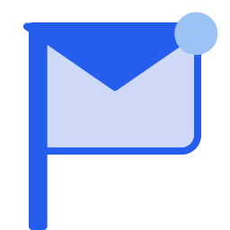

#  PriorityBox

**What if your inbox told you what matters before you had to read it?**

PriorityBox is a desktop email dashboard for Gmail and Outlook. It ranks every email by urgency, pulls out deadlines and events, tracks what you're waiting on, and lets you search, group and re-prioritise your mail by just asking an AI assistant.

<p align="left">
  
</p>

---

## Table of contents

- [Project overview](#project-overview)
  - [Purpose](#purpose)
  - [How it works](#how-it-works)
- [Getting started](#getting-started)
  - [Clone the repository](#clone-the-repository)
  - [Install dependencies](#install-dependencies)
  - [Environment variables](#environment-variables)
  - [Firebase setup](#firebase-setup)
  - [Connecting Gmail](#connecting-gmail)
  - [Connecting Outlook](#connecting-outlook)
  - [Running the app](#running-the-app)
  - [Releases and auto-updates](#releases-and-auto-updates)
- [Features and usage](#features-and-usage)
- [Technologies used](#technologies-used)
- [License](#license)

---

## Project overview

### Purpose

Inboxes are sorted by time, not by importance, so urgent emails get buried under newsletters and threads that can wait. PriorityBox reads your mail with an AI model and puts what needs your attention first: what is urgent, what has a deadline, and what is still waiting on a reply. When you need something specific, you ask for it in plain words instead of building search filters.

### How it works

1. **Connect your inboxes.** Sign in, then connect Gmail and/or Outlook. Access is read-only: PriorityBox can never send, delete or move your mail.
2. **Your mail is analysed.** Each page of 25 emails is sent to Groq, which returns a priority, any event date, whether you're waiting on someone, and a progress estimate. Results are stored once so nothing is analysed twice.
3. **You work from the dashboard.** The Priority inbox splits mail into *Needs attention* and *Everything else*. Every card is one compact line that expands to show the email, an AI summary and a draft reply.
4. **You ask the AI for the rest.** The AI bar takes instructions like *"group my invoices from Acme"* or *"mark every newsletter as low priority"* and works through your inbox step by step.

| Mode | What happens |
|---|---|
| `Mail` | Your connected Gmail and Outlook inboxes, merged into one newest-first feed |
| `Manual` | Matters you type in yourself, tracked with the same priorities, dates and progress |

---

## Getting started

### Clone the repository

```bash
git clone https://github.com/KBOlifant/PriorityBox.git
cd PriorityBox/frontend
```

### Install dependencies

Requires **Node.js 22** or newer.

```bash
npm install
```

### Environment variables

**1. Create your `.env` file.** Copy `.env.example` to `.env` in the `frontend` folder. `.env` is git-ignored, so your keys stay on your machine.

```ini
# Firebase (web config)
NEXT_PUBLIC_FIREBASE_API_KEY=your_api_key
NEXT_PUBLIC_FIREBASE_AUTH_DOMAIN=your_project.firebaseapp.com
NEXT_PUBLIC_FIREBASE_PROJECT_ID=your_project_id
NEXT_PUBLIC_FIREBASE_STORAGE_BUCKET=your_project.appspot.com
NEXT_PUBLIC_FIREBASE_MESSAGING_SENDER_ID=your_sender_id
NEXT_PUBLIC_FIREBASE_APP_ID=your_app_id
NEXT_PUBLIC_FIREBASE_MEASUREMENT_ID=your_measurement_id

# Groq (AI)
NEXT_PUBLIC_GROQ_API_KEY=your_groq_key

# Gmail in the browser (OAuth "Web application" client)
NEXT_PUBLIC_GOOGLE_CLIENT_ID=your_web_client_id

# Gmail in the desktop app (OAuth "Desktop app" client)
NEXT_PUBLIC_DESKTOP_APP_GOOGLE_CLIENT_ID=your_desktop_client_id
NEXT_PUBLIC_DESKTOP_APP_GOOGLE_CLIENT_SECRET=your_desktop_client_secret

# Outlook (Entra app registration)
NEXT_PUBLIC_MICROSOFT_CLIENT_ID=your_microsoft_client_id
```

**2. Get a Groq key.** Create a free API key at [console.groq.com](https://console.groq.com). PriorityBox uses the `openai/gpt-oss-120b` model.

> **Note:** `NEXT_PUBLIC_` values are built into the app. That's fine for development, but anyone who unpacks a built installer can read them, so don't share builds that contain keys you need to keep private.

### Firebase setup

1. Create a project in the [Firebase console](https://console.firebase.google.com) and add a **Web app** to get the config values above.
2. **Authentication:** enable the **Email/Password** and **Google** sign-in providers.
3. **Firestore:** create a database, then deploy the rules in `frontend/firestore.rules`. They restrict every user to their own data under `users/{uid}`.

### Connecting Gmail

In the [Google Cloud console](https://console.cloud.google.com) (the project behind your Firebase app works):

1. Enable the **Gmail API**.
2. **OAuth consent screen:** user type *External*, add the scope `https://www.googleapis.com/auth/gmail.readonly`, and add yourself under *Test users*.
3. **Credentials → Create OAuth client ID:**
   - **Web application** with the authorised JavaScript origin `http://localhost:3000`, for `NEXT_PUBLIC_GOOGLE_CLIENT_ID`.
   - **Desktop app**, for `NEXT_PUBLIC_DESKTOP_APP_GOOGLE_CLIENT_ID` and `NEXT_PUBLIC_DESKTOP_APP_GOOGLE_CLIENT_SECRET`. The desktop app signs in through your browser and a local loopback address.

> **Note:** Google's Desktop app clients need the client secret to finish sign-in. If connecting Gmail fails in the desktop build, check that the secret is set.

### Connecting Outlook

In the [Microsoft Entra admin center](https://entra.microsoft.com) → **App registrations**:

1. **New registration**, with supported account types *Accounts in any organizational directory and personal Microsoft accounts*.
2. **Authentication → Add platform → Single-page application**, with the redirect URIs `http://localhost:3000/auth/redirect` (browser) and `http://localhost:38417/auth/redirect` (desktop app).
3. **API permissions → Microsoft Graph → Delegated:** `Mail.Read` and `User.Read`.
4. Put the *Application (client) ID* in `.env` as `NEXT_PUBLIC_MICROSOFT_CLIENT_ID`.

### Running the app

| Command | What it does |
|---|---|
| `npm run dev` | Runs the app in your browser at `http://localhost:3000` |
| `npm run electron:start` | Builds the app and opens it as a desktop app |
| `npm run dist` | Builds the Windows installer into `frontend/dist` |

Restart the dev server after changing `.env`, then use **Connect inbox** in the sidebar.

### Releases and auto-updates

Every push to `main` runs the **Release** GitHub Action. It builds the Windows installer and publishes it as a GitHub release, and installed copies of PriorityBox update themselves from there.

The workflow reads the same values as `.env`, so add each one under **Settings → Secrets and variables → Actions** in your GitHub repository.

> **Note:** work on a feature branch and merge when you're ready, since every push to `main` ships a new version.

---

## Features and usage

### Priority inbox
- Mail is split into **Needs attention** and **Everything else**, with **Waiting**, **Events**, **Archive** and **All mail** views in the sidebar.
- Each email is one Gmail-style line (sender, subject and a preview) that expands to the full email, an **AI summary** and a **draft reply**.
- Filter by priority, search by text, and page through your inbox 25 emails at a time.

### AI assistant
Type an instruction into the AI bar on the Priority inbox:

| Try | What happens |
|---|---|
| *"show me invoices from Acme"* | Finds the emails and shows them in place of your inbox |
| *"group everything about the product launch"* | Finds them and offers to save them as a folder |
| *"mark every newsletter as low priority"* | Proposes the changes for you to approve |
| *"emails from 2025 about contracts"* | Searches older inbox mail and asks how far back to look |

- **Typo-tolerant:** *"invocie"* still finds *"invoice"*. The AI fixes your spelling, and the local search matches typos too.
- **Shows its work:** you see each step as it happens (*"Searched loaded mail for “invoice”: 9 matches"*), and the result records the steps and tokens used.
- **Token-aware:** each step sends only what's needed, and big searches tell you the estimated cost before running.
- **You stay in control:** the AI only proposes changes. Priority changes and new urgency rules wait for **Apply** or **Remember**, and applied changes can be undone.

### Grouped Emails
- Save any AI result as a folder, or tick emails yourself with the checkbox on each card and choose **Group into folder**.
- Folders live under **Grouped Emails** in the sidebar, where you can rename or delete them. Each email opens straight from your inbox.

### Saved for later
- Bookmark any email, and High priority emails are saved automatically. Track each one with an activity, an event date, progress notes and remarks.

### Custom memory
- Under **Settings → Custom memory**, write notes the AI should always keep in mind, like *"My manager is Sarah Lee. Her emails are always urgent."* They're included with every AI request, and only you can change them.

### Privacy and offline use
- Mailbox access is read-only. Email bodies are never stored in the cloud: Firestore keeps references (sender, subject, ids), the AI's analysis, and the summaries and drafts it wrote for you.
- Emails, AI results and searches are cached on your device in IndexedDB, so things load instantly and the mail APIs are called as little as possible. Everything cached is cleared when you sign out.

---

## Technologies used


- **Next.js and React:** the app's screens, built as a static export for the desktop app
- **TypeScript:** the whole codebase
- **Tailwind CSS and Framer Motion:** styling, light and dark themes, and animations
- **Electron:** the Windows desktop app, with secure Google sign-in and auto-updates through `electron-updater`
- **Firebase:** sign-in (Auth) and storage for settings, saved emails, folders and AI results (Firestore)
- **Groq (`openai/gpt-oss-120b`):** email analysis, summaries, reply drafts and the AI assistant
- **Gmail API and Microsoft Graph:** read-only access to your inboxes
- **IndexedDB:** the on-device cache for emails, searches and AI results

---

## License

No license has been chosen for this project yet, so all rights are reserved by the author.
